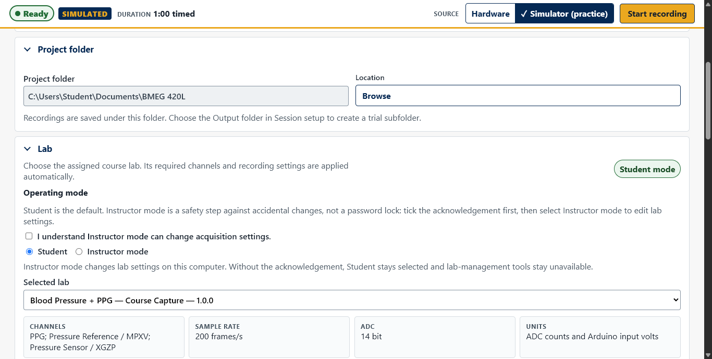
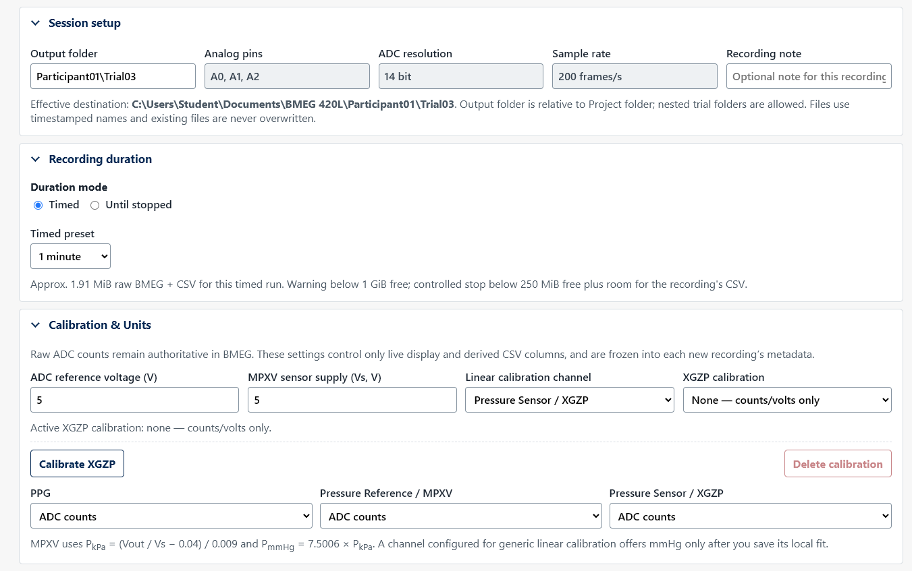
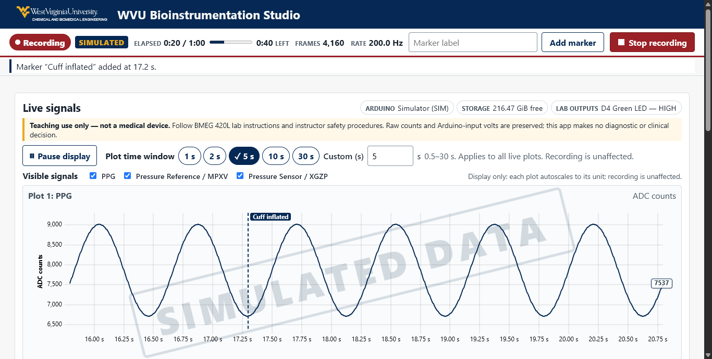
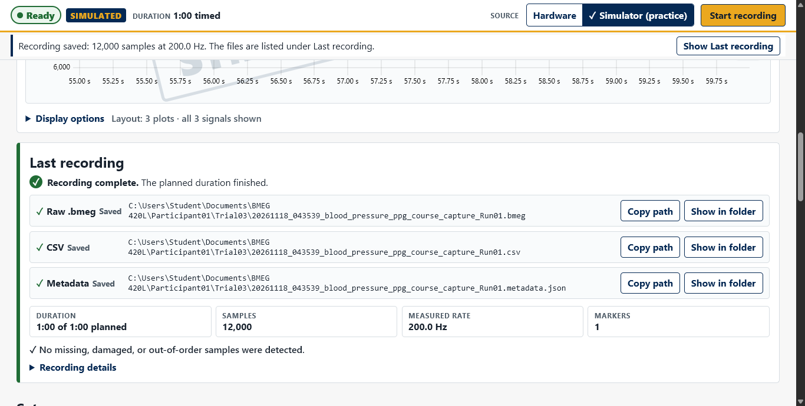

# WVU Bioinstrumentation Studio

WVU Bioinstrumentation Studio is a Windows desktop application for BMEG 420L. It acquires, visualizes, calibrates, and saves synchronized biomedical-instrumentation signals from an Arduino UNO R4 WiFi and course hardware.

Teaching use only — not a medical device. Follow BMEG 420L lab instructions and instructor safety procedures. Do not use this software for diagnosis or clinical decisions.

## Capabilities

- Automatic Arduino UNO R4 WiFi discovery, WVU firmware verification, and controlled firmware restoration with a guided restore window.
- ECG capture; EMG + pressure capture; blood pressure + PPG capture; raw LED-sequenced pulse-ox capture (one row per RED/DARK/IR/DARK state, optionally with other analog signals); and Op Amp Lab capture (Vmid and Vout).
- Synchronized acquisition of one to six analog channels with configurable plot grouping and per-trace visibility.
- Color-coded legends for plots containing multiple visible signals, a synchronized 0.5–30 s live display window, and persistent newest-value labels in the selected display units.
- Display-only decimation for longer live windows while recorded BMEG and CSV data remain full-rate.
- Live plot time axes use elapsed recording seconds, starting at 0 for the first accepted frame; they are not calendar timestamps.
- Firmware-measured timestamps are preserved for every synchronized record, including each pulse-ox LED state.
- Counts, volts, MPXV pressure conversion, and student-created local linear calibration for supported channels.
- Project-folder and trial-folder organization with automatic raw BMEG, CSV, and metadata output. Recording markers are preserved in metadata.
- Every recording is finalized, even when it ends early. The metadata is written before the CSV, and a summary card shows which files were saved.
- Instructor-managed, versioned course-lab definitions with factory defaults, import/export, and safe pin/rate/output configuration.

The distributed application bundles the Arduino command-line runtime and UNO R4 core. Students do not need Arduino IDE or Arduino CLI for normal use.

## Interface overview

The application is a single window.

**Recording bar.** It stays at the top while you scroll. When the app is ready, it shows:

- The state, for example **Ready** or **Recording**
- A **SIMULATED** tag when the Simulator is in use
- The planned duration
- **Source**: **Hardware** or **Simulator (practice)**
- **Start recording**

If Start is not possible yet, a checklist (Board · Firmware · Lab · Folder · Source) names what is missing. While recording, the bar shows elapsed and remaining time, frames, measured rate, an optional marker label with **Add marker**, and **Stop recording**.

**Message center.** It sits directly under the bar. It shows at most one problem at a time in plain language, usually with a single button for the next step: for example **Retry connection**, **Verify Firmware**, **Restore WVU Firmware**, **Clear connection**, or **Repair Arduino tools**.

**Setup cards.** Below them, the **Setup** cards (Board, Project folder, Lab, Session setup, Recording duration, Calibration & Units) can collapse to one-line summaries and are read-only while recording.

### Board

The **Board** card lists the connected UNO R4 WiFi boards next to **Refresh Board** and a status chip, for example:

- **No board selected**
- **Checking…**
- **Not checked**
- **Ready on COM5**
- **Port busy**
- **No WVU firmware**
- **Needs attention**
- **Restoring firmware…**

The card offers the one action that fits the state. **Verify Firmware** and **Restore WVU Firmware** are always available, as the card's main action or under **More board actions**, whatever the firmware status. Verify only reads from the board; it never uploads.

**Restore WVU Firmware** opens a step-by-step window: Prepare, Compile, Switch board to upload mode, Upload, Reconnect, Verify. For a board already running the WVU firmware, it shows a 90-second countdown to press the RESET button twice quickly. Restore is refused while more than one UNO R4 WiFi is connected.

The **Last firmware operation** card keeps the result, the next step, the log path, and **Copy diagnostics**. If the bundled Arduino tools need attention, the Board card offers **Repair Arduino tools**.

### Project and lab selection

Choose the Project folder and the assigned course lab. Lab definitions apply the required channels, sampling settings, ADC resolution, plot defaults, and supported display or calibration options. Instructor mode (tick the acknowledgement first, then select **Instructor mode**) adds **Manage Labs**.

### Session setup and calibration

In these cards you can:

- Set a relative Output folder and an optional recording note. The effective destination always stays inside the selected Project folder.
- Choose **Timed** or **Until stopped** (the lab decides which are offered).
- Check the storage estimate for the raw BMEG plus CSV.
- Set the ADC reference and MPXV supply voltages, the display unit of each channel, and any local linear calibration.

### Live signals

This screenshot shows practice data from **Simulator (practice)**, so every plot carries the **SIMULATED DATA** watermark. With **Source: Hardware**, the plots show the board's signals and no watermark. From the first recording on, Live signals (and later the Last recording card) come before the setup cards, so Stop and the plots are visible together.

Live plots are display-only. Changing plot groups, trace visibility, engineering units, or the synchronized time window does not change the raw acquisition.

- **Time window.** Choose 1, 2, 5, 10, or 30 s, or a custom 0.5–30 s. It applies to all live plots.
- **Time axis.** It shows elapsed recording time, beginning at 0 s for each recording.
- **Pause.** **Pause display** freezes the plots while recording continues.
- **Markers.** Markers appear as labelled lines.
- **Values and legends.** Each visible trace shows its newest rounded value in the selected display unit, and multi-signal plots include a color-coded legend.
- **Decimation.** Longer windows may use display-only decimation to keep the interface responsive. Raw recordings remain full-rate and are not changed by display settings.

### Last recording

After each recording, the **Last recording** card shows:

- Whether it completed, or why it stopped early
- Each file marked ✓ Saved or ✗ Not saved, with **Copy path** and **Show in folder**
- The duration, sample count, measured rate, and marker count
- A one-line data-quality check

The folder paths in these screenshots show an example Project folder, `C:\Users\Student\Documents\BMEG 420L`.

## Requirements

- Windows x64, primarily Windows 11.
- Arduino UNO R4 WiFi.
- The relevant BMEG 420L course hardware and instructor-approved setup.
- Administrator approval to install the primary system-wide installer; the application runs normally without elevation after installation.

## Getting started

1. [Install the application](docs/INSTALLATION.md).
2. Connect the Arduino UNO R4 WiFi and open the application.
3. Check the **Board** card: it should read **Ready on COMx**. Otherwise use the action it offers (Verify Firmware or Restore WVU Firmware).
4. Select a Project folder, choose the assigned course lab, and set an Output folder for the trial.
5. Check that **Source** in the recording bar is **Hardware**, then select **Start recording**.
6. Retrieve the generated files from the **Last recording** card or the selected Project/Output folder.

During a recording, you may rearrange plots, hide or show traces, change supported display units, adjust or pause the shared live display, read newest-value labels, and add markers without affecting the underlying full-rate recording.

See the concise [Student Quick Start](docs/STUDENT_QUICK_START.md) and the [Troubleshooting guide](docs/TROUBLESHOOTING.md).

## Course labs

| Lab | Default inputs | Default rate | Default ADC |
| --- | --- | ---: | ---: |
| ECG — Course Capture | A0 ECG | 1000 frames/s | 14 bit |
| EMG + Force — Course Capture | A0 raw EMG, A1 rectified EMG, A2 envelope, A3 pressure surrogate | 1000 frames/s | 14 bit |
| Blood Pressure + PPG — Course Capture | A0 PPG, A1 MPXV, A2 XGZP; D4 green LED | 200 frames/s | 14 bit |
| Pulse Oximetry — TX + RX Raw Capture | A0 TX, A1 RX; D5 red, D6 IR | 1000 rows/s (one per LED state) | 14 bit |
| General Analog — Development | 1–6 inputs selected from A0–A5 | 1000 frames/s | 14 bit |
| Op Amp Lab | A0 Vmid, A1 Vout | 100 frames/s | 14 bit |

More detail is in [Lab Configuration](docs/LAB_CONFIGURATION.md). Instructors should use the [Instructor Guide](docs/INSTRUCTOR_GUIDE.md).

## Data files

Raw `.bmeg` data are authoritative. Each recording also produces a `.metadata.json` sidecar and a profile-aware CSV in the effective session folder. Raw counts are always retained; voltage and engineering-unit columns are derived from the recording-time settings. The file layouts and CSV column rules are in [Calibration and Units](docs/CALIBRATION_AND_UNITS.md#recording-files).

Generated filenames start with the local date and time, then the selected lab's export name and the run number, for example `20261118_043539_blood_pressure_ppg_course_capture_Run01.csv`. They do not use internal development-phase labels. Existing files are never overwritten.

Live plot windowing, trace visibility, legends, endpoint labels, and display decimation do not alter the recorded raw samples.

Pulse oximetry schedules RED, DARK 1, IR, and DARK 2 on one absolute firmware timeline, reads every input of the lab at the end of each state, and preserves the raw measurements, the LED state of each row, and the actual timestamps. The firmware for this version is build `0x00010007`: after updating the app on every lab computer, restore each board once. Bounded acquisition and transmit queues keep packet construction and USB backpressure out of the sampling path and report overflow explicitly. The application does not subtract ambient states, calculate SpO2, calculate heart rate, or perform physiological interpretation.

## Building from source

Development requirements, commands, the bundled Arduino runtime, and the production-build distinction are documented in the [Developer Guide](docs/DEVELOPER_GUIDE.md). Use the Tauri production build pipeline; a plain Cargo release build is not a distributable application because it does not package the frontend assets.

For continuing development on a new computer or with a new coding agent, see the [Maintainer and Agent Handoff](docs/AGENT_HANDOFF.md).

## Documentation

- [Installation](docs/INSTALLATION.md)
- [Student Quick Start](docs/STUDENT_QUICK_START.md)
- [Instructor Guide](docs/INSTRUCTOR_GUIDE.md)
- [Lab Configuration](docs/LAB_CONFIGURATION.md)
- [Calibration and Units](docs/CALIBRATION_AND_UNITS.md)
- [Hardware](docs/HARDWARE.md)
- [Troubleshooting](docs/TROUBLESHOOTING.md)
- [Architecture](docs/ARCHITECTURE.md)
- [USB Protocol](docs/USB_PROTOCOL.md)
- [Developer Guide](docs/DEVELOPER_GUIDE.md)
- [Release Checklist](docs/RELEASE_CHECKLIST.md)
- [Changelog](CHANGELOG.md)

## License

WVU Bioinstrumentation Studio is licensed under the Apache License 2.0. See [LICENSE](LICENSE) and [NOTICE](NOTICE).

Third-party components bundled with or used by the project remain subject to their respective licenses. See [Third-Party Notices](docs/THIRD_PARTY_NOTICES.md).

## Acknowledgments

WVU Bioinstrumentation Studio was developed for biomedical instrumentation teaching and laboratory use at West Virginia University.

### AI-assisted development

Development of WVU Bioinstrumentation Studio used OpenAI's ChatGPT and Codex, and Anthropic's Claude (through Claude Code), as AI-assisted software-development tools for tasks including design exploration, code generation and refactoring, debugging, test planning, code review, and documentation. AI-generated suggestions were reviewed, modified where necessary, tested, and accepted by the project maintainer before integration.

OpenAI and Anthropic are not sponsors of, and do not endorse, this project.
