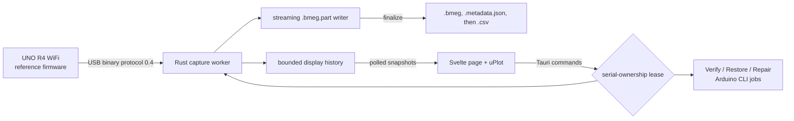

# Architecture

WVU Bioinstrumentation Studio is a Tauri 2 desktop application with a Svelte/TypeScript frontend and a Rust backend. The Arduino UNO R4 WiFi runs the repository-controlled reference firmware.

## Acquisition and firmware

- The firmware provides synchronized logical frames with measured per-record timestamps. Analog channels are read one after another within a frame, not electrically simultaneously.
- Pulse-ox phase deadlines advance on one absolute timeline. Bounded raw-batch and transmit queues, plus partial-write service, keep sample deadlines independent of packet construction and USB backpressure.
- Dropped batches and skipped deadlines are counted explicitly (`firmware_overflows`, `overrun_flagged_records`); see [USB Protocol](USB_PROTOCOL.md).
- The Rust session owns serial I/O, packet validation, CRC and sequence accounting, full-rate storage, and finalization. Raw BMEG samples are authoritative. Plot grouping, visibility, units, legends, endpoint labels, and display decimation never reach acquisition or raw storage.

## Backend structure

| Area | Files |
| --- | --- |
| Tauri commands, startup, window close | `src-tauri/src/lib.rs`, `main.rs` |
| Session state, capture worker, finalization, display history | `session.rs`, `acquisition.rs` |
| Serial-ownership lease | `serial_lease.rs` |
| Frame codec, CRC, integrity counters | `protocol.rs` |
| BMEG, CSV, and metadata | `recording.rs` |
| Restore and Verify jobs, Arduino CLI processes, runtime extraction, reference sketch pins | `firmware_workflow.rs`, `arduino_cli.rs`, `arduino_runtime.rs`, `reference_firmware.rs` |
| Lab catalog | `profiles.rs` |
| Calibration | `calibration.rs` |
| Project and Output folder paths | `project_paths.rs` |
| Application log | `app_log.rs` |

### Commands off the main thread

Commands that open the serial port, run the Arduino CLI, wait for the lab catalog lock, or touch the disk at length are `async`. They do their blocking work in `tauri::async_runtime::spawn_blocking`, so the window keeps painting and polling while it runs. This covers:

- Start (`start_profile_hardware_recording`, `start_profile_simulator_recording`), `retry_hardware_handshake`, `verify_wvu_reference_firmware`, `restore_wvu_reference_firmware`, and `disconnect_session`
- `list_boards`, `prepare_arduino_runtime`, `repair_arduino_runtime`, and `estimate_recording_storage`
- The lab-catalog writes

`disconnect_session` asks the worker to stop and returns; status polling observes the result.

Short reads and requests stay synchronous: `get_session_status`, `get_recent_display_data`, `stop_recording`, and `add_recording_marker`.

Command argument names and nested serde payload names are part of the frontend contract and must stay aligned with their callers.

### Serial-ownership lease

`serial_lease.rs` allows one owner of the COM port and the shared session at a time:

- `Session`: a recording, from Start until it is saved
- `FirmwareJob`: a restore
- `Verify`
- `Retry`
- `ToolRepair`: Repair Arduino tools

Every one of these operations claims the lease first. The claim is atomic. A conflicting claim is refused with a student-readable busy message instead of opening the port twice. A claim waits up to 500 ms for a previous owner that has already published its final state and is returning. The lease is released by `Drop` on every exit path, including errors and panics, so a failed operation always releases serial ownership and busy state.

### Session state

`SessionState` is one of `Disconnected`, `Connecting`, `Connected`, `Configured`, `Acquiring`, `Stopping`, or `Faulted`.

Verify Firmware, Retry connection, and a restore's verification also pass through `Connecting` and `Connected` while they handshake. `SessionStatus.recording_active` tells these cases apart. It is true only while a Start owns the session, from `Connecting` through `Stopping`, and false during a board check. The page locks setup and shows recording controls only when it is true.

A fault sets `last_error` together with `fault_origin`:

| `fault_origin` | Meaning |
| --- | --- |
| `verification` | Verify Firmware, including a restore's verification |
| `connection` | Retry connection, or a hardware Start that failed before START |
| `recording` | Acquisition ended by a serial, firmware, or session failure |
| `storage` | The folder or files could not be used (refused before START) or saved |
| `request` | The request was refused before START |

The message center chooses its text and its single next action from this field, so a failed Verify is never described as a recording that ended. Two further distinctions are made on the page, without new fields:

- A `storage` fault with no `last_summary` was raised before START (for example less than 250 MiB free). It is shown as "The recording could not start" with the reason from `last_error`; "not saved completely" is kept for a save that failed after a recording.
- `simulator` describes the last recording and is not reset by Verify, Retry connection, or a restore's verification (the SIMULATED DATA watermark needs it). A fault counts as a simulator recording's fault only while `port` is still `SIM` and the origin is not `verification`.

Closing the window uses the same `recording_active` test: during a Verify or Retry handshake the window closes normally, and only a recording is stopped and saved first.

A hardware Start after a fault waits until Verify or **Clear connection** clears it. A Simulator Start does not wait.

### Firmware readiness and recovery

Firmware readiness is bound to a port:

- `verified_port` is set by a successful Verify (or the verification at the end of a Restore). Any failed verification and the start of any firmware job clear it. So does a Retry connection or hardware Start handshake on that port whose `failure_category` proves other firmware (`non_protocol_bytes`, `wrong_protocol_version`, `missing_firmware_identity`, `incompatible_firmware_identity`); the workflow applies it when its status or Start readiness is next read.
- After a failed or canceled restore, the page refreshes the board list and follows a board that appeared on another port, but does not verify it, so the Board card keeps the restore's failure, log path, and advice. Advanced details always shows the last restore's result and log path.
- A hardware Start requires a compatible result on the selected port, and that port must equal `verified_port`.
- A Verify that cannot open the port reports `PortBusy` and keeps the previous compatibility result.

Board recovery is independent of readiness. Refresh, Verify, and Restore are available whatever the firmware status, and Verify never uploads.

Restore runs as follows:

- It is refused while more than one UNO R4 is connected.
- It compiles the controlled sketch with the app-owned Arduino runtime. A board that already runs the native-USB WVU firmware must be double-reset by hand within 90 s to reach upload mode.
- Arduino CLI children run in a kill-on-close Windows Job Object with timeouts and `CREATE_NO_WINDOW`.
- Cancel is refused once the job reaches `Uploading`, and the window cannot be closed while a firmware job is active.

**Reset board and retry** was retired: it could not reach the native-USB firmware. Recovery is Retry connection, then Verify, then Restore.

### Capture worker

A recording runs on one worker thread:

1. **Handshake.** The worker opens the port and completes the handshake.
2. **Quiesce.** It sends an idle-safe STOP.
3. **Configure.** It sends CONFIGURE and waits for CONFIG_ACK.
4. **Open the raw file.** It creates `<name>.bmeg.part` (`create_new`, so an existing file is never truncated).
5. **START.** It sends START and waits for a STATUS with `acquiring = 1`.
6. **Capture.** The capture loop reads frames, writes validated records, and checks free space every 15 s. It PINGs every second and enforces the seven-second no-data safeguard. Sample batches (and the overflow and timing counters of STATUS frames) that arrive before the START STATUS are ignored because they belong to an earlier run, and an ERROR from an earlier session is logged, not counted.
7. **Stop.** STOP is always sent. The worker then waits up to 300 ms for a STATUS newer than STOP and drains the tail. A STOP whose write timed out, or that is unanswered after 100 ms, is sent again (at most twice, each extending the wait by up to 100 ms).
8. **Finalize.** The recording is always finalized, whatever ended it: a user Stop, the timed end, window close, disconnect, the storage guard, or a fault.

While a recording runs, a Windows power request (`PowerSetRequest`, `PowerRequestSystemRequired`) keeps the PC from sleeping. It is held from the worker's start through finalization.

**Storage guard.** It stops the recording (as `storage_guard`) when free space falls below 250 MiB plus the projected size of the recording's CSV. It warns below 1 GiB free, or earlier by the same margin when the CSV reserve raises the stop threshold. A failed free-space query is logged and is not fatal.

**Finalize order:**

1. Finish and fsync the BMEG.
2. Rename it from `.part`, with a bounded retry.
3. Write `.metadata.json` durably.
4. Export the CSV (best effort, through `.csv.part`).
5. Rewrite the sidecar with `csv_filename` or `csv_error`.

A raw file is never deleted. Each failed step is logged as `FINALIZE_FAIL stage=…` and reported in `finalize_error`. `SessionError::Cancelled` is the only worker ending that is not reported as a fault.

### Display data

The session keeps up to 30,000 recent frames (30 s at 1 kHz). `get_recent_display_data` returns at most 2,000 points per request for the selected 0.5–30 s window. Decimation always includes the newest frame.

## Frontend structure

`src/routes/+page.svelte` is the single window. It owns the application state, polls `get_session_status` every 40 ms while a recording or Start is active and every 250 ms while idle, fetches display data only when it can have changed, and wires the components together:

| Component (`src/lib/components/`) | Role |
| --- | --- |
| `RecordingBar` | Sticky bar: state chip, SIMULATED tag, Source (Hardware / Simulator (practice)), Start recording, elapsed/remaining, frames, rate, marker label and Add marker, Stop recording, Clear connection. Includes `ReadinessChecklist` (Board · Firmware · Lab · Folder · Source). |
| `MessageCenter` | One problem banner (announced once as an alert) with usually one next action and sometimes a secondary button, plus an information line that is the page's only `aria-live` region |
| `SetupCard` | Collapsible card with a one-line summary; the setup cards are read-only while recording |
| `BoardPanel` | Board list, Refresh Board, state chip, the fitting action, More board actions (Verify, Restore, Repair Arduino tools), and the Last firmware operation card |
| `FirmwareJobProgress` | Restore stepper (Prepare, Compile, Switch board to upload mode, Upload, Reconnect, Verify), the double-reset countdown, and Cancel restore |
| `LabCard` | Operating mode (`OperatingModeControl`), Lab Manager (`LabManager`, Instructor mode only), lab selection, **Install lab file…** (both modes), lab details, and a catalog migration notice (both modes) |
| `SessionCard`, `DurationCard` | Output folder, recording note, lab acquisition settings; duration mode, presets, and the storage estimate |
| `CalibrationCard`, `CalibrationDialog` | Vref and Vs, calibration selection, display units, and the linear-fit dialog |
| `LiveSignalsPanel` | Live signals: `PlotToolbar` (Pause display, time-window chips) and one `LivePlot` (uPlot) per plot group, marker lines, and the SIMULATED DATA watermark |
| `RecordingResultCard` | Last recording: per-file ✓/✗, Copy path, Show in folder, and a quality summary |
| `AdvancedDetails` | Raw diagnostics for instructors |
| `Modal`, `CopyButton` | Accessible modal dialog (focus trap, Escape, focus return) and copy-to-clipboard |

The page's decisions live in pure TypeScript modules in `src/lib/`, tested by the Vitest `*.test.ts` files beside them:

| Module | Decides |
| --- | --- |
| `messages.ts` | Every plain-language failure text and next action |
| `readiness.ts`, `recording-start.ts` | The Start gate and the checklist |
| `board-panel.ts`, `board-controls.ts`, `board-cache.ts` | Board state, controls, and selection |
| `firmware-job.ts` | The restore steps |
| `source-select.ts` | The one-time automatic switch to Hardware |
| `recording-result.ts`, `recording-status.ts` | The result card and the recording bar |
| `live-display.ts`, `multichannel.ts` | The plot window, ticks, and colours |
| `calibration*.ts` | Calibration |
| `storage.ts` | Storage |
| `lab-catalog.ts`, `lab-authoring.ts` | The Lab Manager |
| `session-types.ts` | Mirrors the Rust status types |

## Labs and runtime

- Lab definitions describe course acquisition, display defaults, supported conversion types, allowed duration modes, and required firmware capabilities. Factory definitions in `profiles/` are immutable. Local instructor revisions are explicit records in a catalog file that is written atomically under a cross-process lock. Apart from recovery after an interrupted save, the only write without a user action is a one-time startup migration at load, under that lock and after a backup copy (`op_amp_builtin_v1`, which retires the old Op Amp Lab copy of General Analog; see [Lab Configuration](LAB_CONFIGURATION.md#catalog-file)).
- Start sends the lab's `profile_version`. The backend refuses to start if the active revision changed after the page loaded it, and the Lab Manager is disabled while recording.
- The Arduino runtime ships inside the installer and is extracted under a cross-process lock to `%LOCALAPPDATA%\WVU-BMEG\rt`. The extracted files are checked at startup, and Repair Arduino tools re-extracts them. A failed Repair reports `previous_runtime_kept` after checking that the tools already in use are still complete on disk; the page then keeps their state, so Restore stays available. Production CLI processes are launched by Rust with hidden Windows console creation and no shell.
